# ROR India

**Find Rails jobs by city, check the company before you apply, and track every application. All in one place.**

Built for the [SerpApi India Hackathon 2026](https://serpapi.github.io/serpapi-india-hackathon-2026/) · Track: **Knowledge & Public Interest**

- Demo video: _add link here_
- Live demo: _add link here (or run it locally, see below)_

---

## What is ROR India?

ROR India is a job board made only for **Ruby on Rails developers in India**. It shows you **where** the Rails jobs are on a map, and gives you the facts you need before you apply:

- **About the job:** city, remote / hybrid / on-site, salary, posted date, the full description, and every place you can apply.
- **About the company:** recent layoffs, head count, office locations, values and founding year, with source links so you can check them yourself.
- **About you:** how well your resume fits the job, and where each of your applications stands.

---

## See it in action: Priya's job search

Meet Priya. She is a Rails developer in **Pune** and wants a job in **Pune or Bengaluru** only. This is her search:

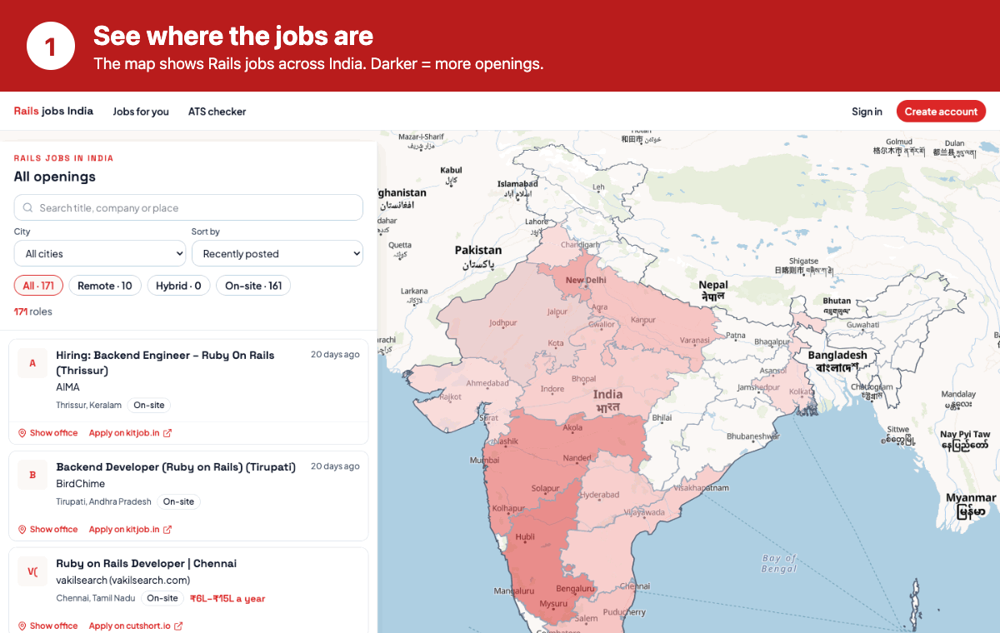

**Why it matters:** hours of searching become minutes. She picks a city with facts, not guesses. She skips weak matches, applies with a better resume, and always knows where each application stands.

<details>
<summary><b>Show the screens, step by step</b></summary>

**1. See where the jobs are**
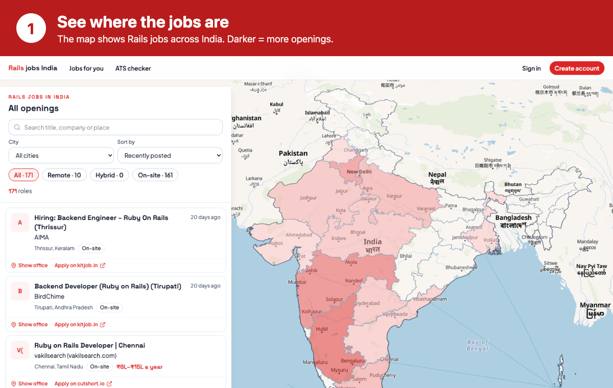

**2. Pick your city: Pune, then Bengaluru**
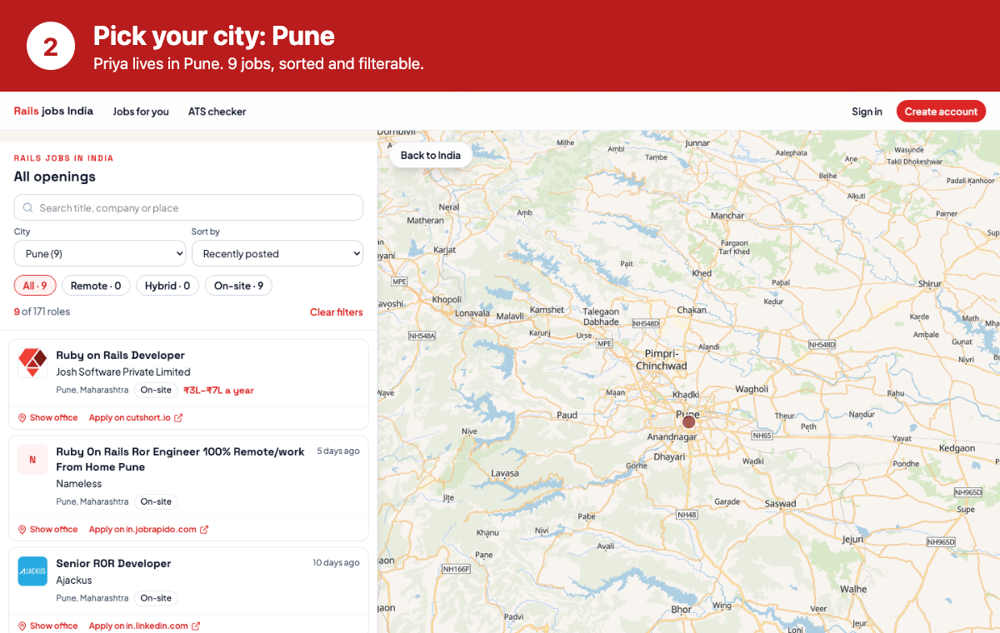
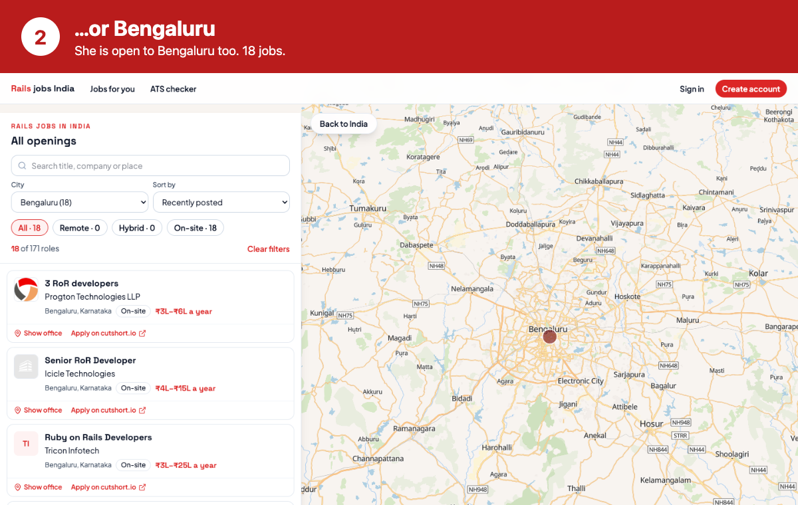

**3. Open a job**
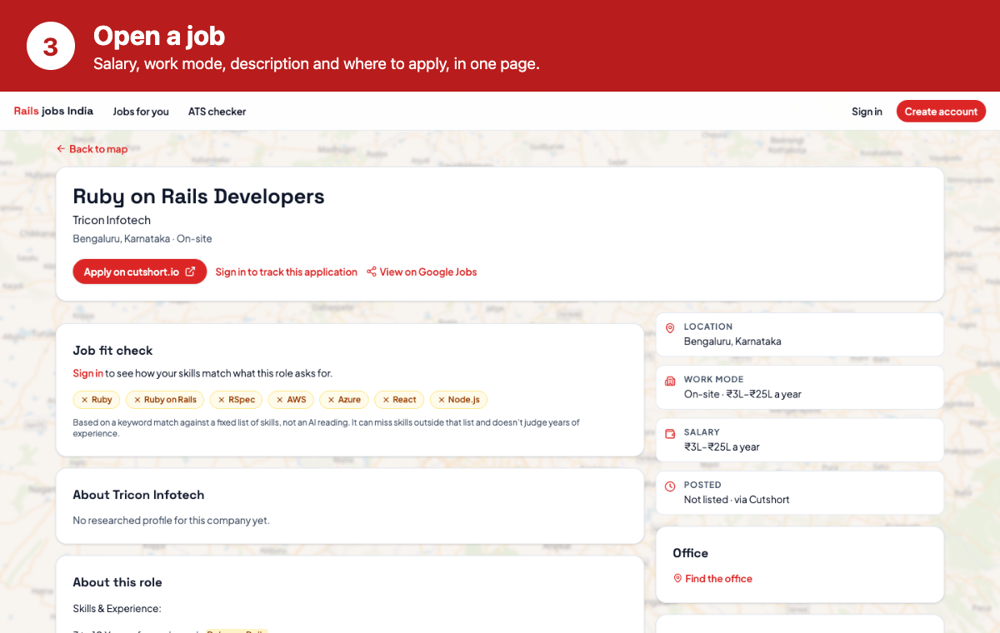

**4. Check the company**
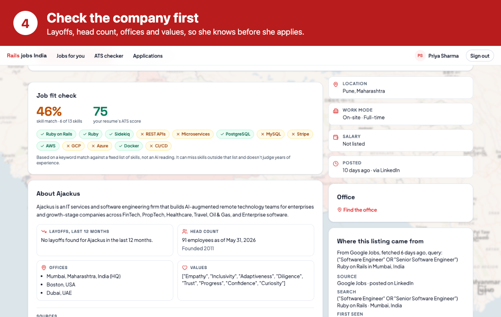

**5. Create an account and upload a resume**
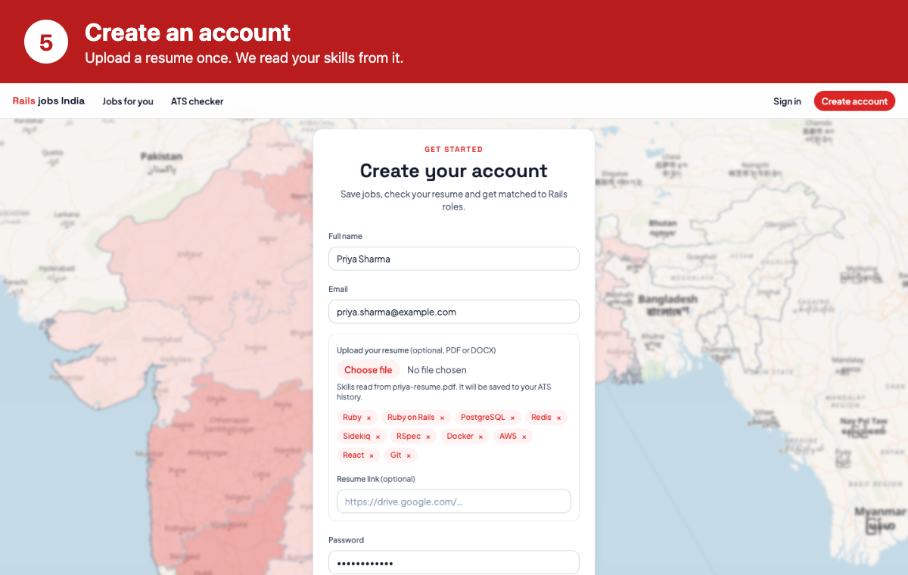

**6. Say what you want**
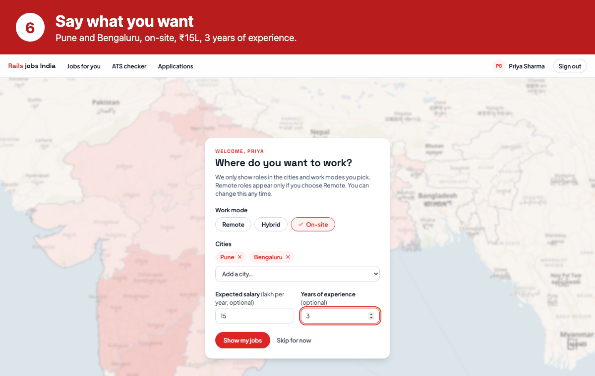

**7. Jobs picked for you**
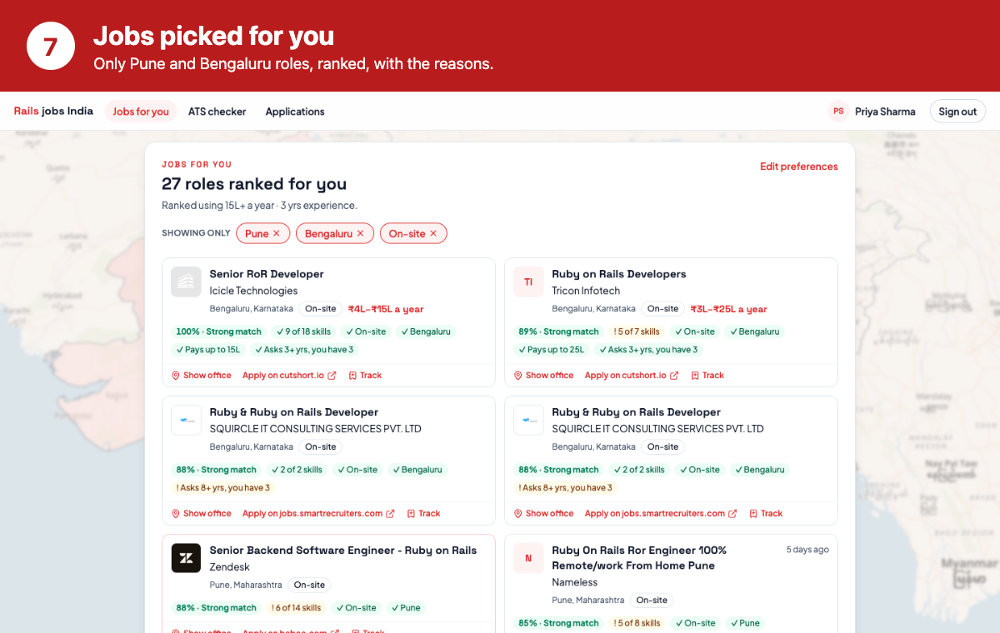

**8. See how well you fit**
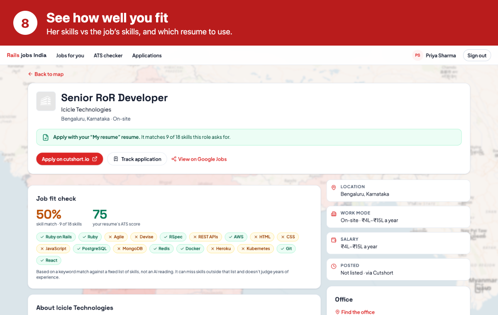

**9. Improve your resume**
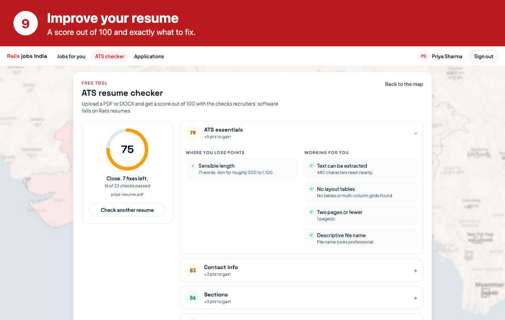

**10. Track every application**
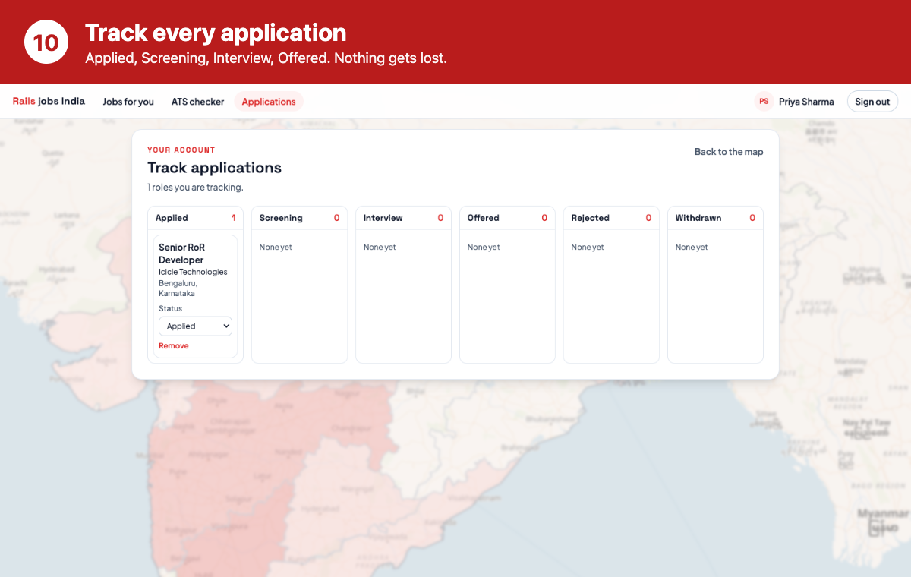

</details>

_The screenshots use a demo account and real jobs from the app's data._

---

## How this is built

### Architecture

- **Frontend:** React, TypeScript, MapLibre (the map), Tailwind.
- **Backend:** Rails API with PostgreSQL. The SerpApi calls live in `api/app/services/serpapi/`.
- **Saved SerpApi data (`api/data/`):** this is not a separate data source. It is real data we fetched from SerpApi (jobs from 8 regions and the company profiles), saved as JSON files. We keep it for development, so we could build and test the whole app without spending SerpApi calls again. This let us finish within the free plan's 250 searches. It also means the app works right after setup.
- **Accounts:** sign up, sign in, and a tracker for your applications.

### How SerpApi is used

SerpApi is the data source of the whole product. Nothing on the map is hand-written.

| SerpApi engine | What it does for the user |
|---|---|
| **Google Jobs** (`google_jobs`) | Finds live Rails openings across India. We keep the full original listing (description, salary, apply links) so nothing is lost or made up. |
| **Google Maps** (`google_maps`) | Finds the company's real office so you know where you would work. |
| **Brave AI Mode** (`brave_ai_mode`) | Builds a short, structured company profile (layoffs, head count, offices, values) and returns the web sources it used. |

How we keep it honest and cheap:

- **Fresh but not wasteful.** Jobs are stored in our database and served from there, so opening the app or a job costs no SerpApi credit. Only the backend job `HarvestJobsJob` (or `bin/rails jobs:harvest`) calls Google Jobs, and it remembers its page position per query.
- **Shows its sources.** Company facts always come with links. If we have no profile for a company, the page says so instead of guessing.
- **One lookup per company.** Offices and profiles are cached, so ten jobs at one company cost one request.
- **Your key stays on the server.** The browser never sees `SERPAPI_KEY`.

### Keeping jobs fresh

Visitors cannot trigger a fetch. `HarvestJobsJob` can run every day at 18:30 UTC (midnight in India) through Solid Queue. The schedule is currently commented out in `api/config/recurring.yml` to save SerpApi credits; uncomment it to turn it on. The Docker image sets `SOLID_QUEUE_IN_PUMA=true`, so the web process runs the scheduler too. On another host set that variable, or run `bin/jobs` as a second process. It needs `SERPAPI_KEY` and retries up to 3 times, 30 minutes apart, if SerpApi fails.

---

## How to run it locally

You need Node 22, Ruby 3.4 and PostgreSQL. A free [SerpApi account](https://serpapi.com) (250 searches/month) is enough.

```bash
# 1. Backend (Rails API on port 3001)
cd api
bundle install
cp .env.example .env          # then put your key in: SERPAPI_KEY=...
bin/rails db:setup
bin/rails data:import         # loads the saved SerpApi jobs and company profiles
bin/rails s -p 3001

# 2. Frontend (in a second terminal, from the repo root)
npm install
npm run dev
```

Open the address Vite prints (usually http://localhost:5173).

Useful commands:

```bash
bin/rails jobs:harvest                          # fetch fresh Rails jobs from SerpApi right now
bin/rails data:fetch_company_profile COMPANY=GitLab   # build one company profile
bin/rails data:fetch_all_company_profiles       # build profiles for every company
bin/rails test                                  # backend tests
npm run lint && npm run build                   # frontend checks
```

The app works with no key too: it shows the saved SerpApi data from `api/data/`. You only need a key to fetch new data.

---

## What is planned

- **New-job alerts.** Pick the companies you dream of working at and get told when they post a Rails role, so you apply on day one, not day ten.
- **Recruiter accounts.** A separate sign-up for recruiters (business email only), so they can post roles and see where Rails talent demand is. Not available yet; every account today is a job seeker.
- **Deeper resume vs job check.** Today the fit check is a keyword match. We want it to also read years of experience and other requirements.

---

## Credits

- **[SerpApi](https://serpapi.com)** for all live data: Google Jobs, Google Maps and Brave AI Mode (see above).
- **[MapLibre GL JS](https://maplibre.org)** and **[react-map-gl](https://visgl.github.io/react-map-gl/)** draw the map.
- **[OpenFreeMap](https://openfreemap.org)** serves the street map tiles, built on data from **[OpenStreetMap](https://www.openstreetmap.org/copyright)** contributors.
- **[Data{Meet} community maps](https://github.com/datameet/maps)** provide the Indian state boundaries.
- **[Turf.js](https://turfjs.org)** works out distances between places.
- **[React](https://react.dev)**, **[Vite](https://vite.dev)**, **[Tailwind CSS](https://tailwindcss.com)**, **[React Router](https://reactrouter.com)** and **[Lucide](https://lucide.dev)** icons build the frontend.
- **[Ruby on Rails](https://rubyonrails.org)**, PostgreSQL, Solid Queue, Blueprinter, `pdf-reader` and `rubyzip` run the backend.
- Fonts: **Plus Jakarta Sans** and **Space Grotesk** from Google Fonts.
- Job logos, descriptions and apply links belong to the employers and job boards that posted them. We link back to the original listing.

---

## Limits (what we do not claim)

- Right now the focus is **Rails jobs** in 8 regions, not every tech job in India.
- Company profiles are AI-assisted summaries from web sources. They are a starting point: check the linked sources before you decide.
- Years of experience and AI fluency read from a resume are keyword and date-range estimates you can edit. "Jobs for you" scores only what both you and the job state; many listings have no salary or no years requirement.
- The job fit check is a keyword match against a fixed skills list. It does not read years of experience or soft requirements.
- Salary and apply links come from Google Jobs and are only as complete as the listing.

## Disclosure

Built with AI help (Claude Code) for coding and review. The backend has an automated test suite (`bin/rails test`).

## Team

_Add team names here._
